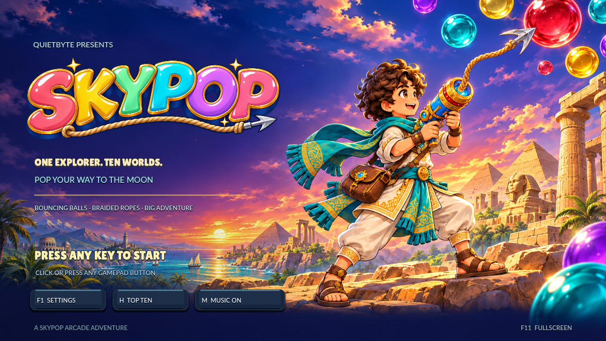
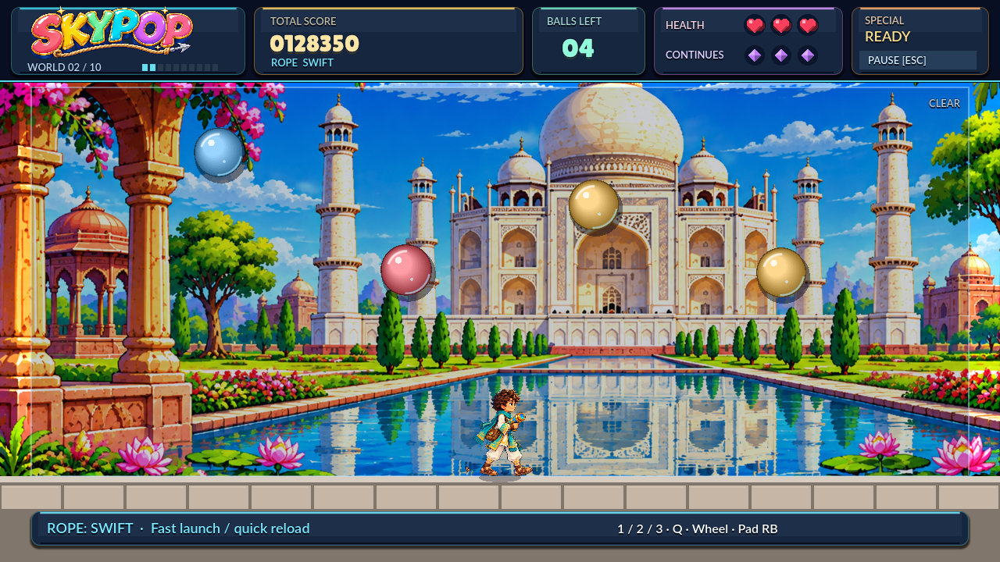

# SkyPop

A colourful Pang-inspired arcade game for Linux and Windows, built with Godot.



Dodge bouncing balls, fire ropes to split them into smaller targets, and clear ten increasingly fast stages. Choose three rope styles, collect weapon upgrades and health, and watch out for steel balls, bombs and fireballs. Features a fullscreen arcade title, gamepad support, stage celebrations, music controls and local high scores.



## Download and play

Download a Linux or Windows package from [Releases](https://github.com/quietbytehq/skypop/releases). Extract the archive and launch `SkyPop` on Linux or `SkyPop.exe` on Windows. Linux users may need `chmod +x SkyPop`. The game starts in fullscreen; F11 toggles windowed mode.

Linux builds target x86_64 with glibc 2.28+ and OpenGL 3.3-compatible graphics. Windows builds target 64-bit Windows 10/11 with compatible graphics. Older systems and ARM are not currently supported or verified. Snap packages require a Linux distribution with snapd. A Snap package does not imply support for every Linux version.

## Controls

| Action | Keyboard / mouse | Gamepad |
| --- | --- | --- |
| Start | Any key / click | Any button |
| Move | A/D or left/right arrows | Left stick |
| Jump | W or up arrow | Left stick up |
| Crouch | S or down arrow | Left stick down |
| Fire rope | Space / left mouse | A / X |
| Special | E / right mouse | Y |
| Choose rope | 1/2/3, Q or mouse wheel | RB |
| Pause | Escape | Start |
| Settings / key bindings | F1 | Use keyboard |
| Music on/off | M | Use title/settings controls |
| Fullscreen | F11 | Use keyboard |
| Title leaderboard | H / Tab | Use title controls |

If a Snap-installed gamepad is not detected, connect its device access with `sudo snap connect skypop:joystick`.

Keyboard controls can be remapped in settings. High scores, settings and bindings are saved locally; there are no accounts or online services.

## Build from source

Install [Godot 4.7.2](https://godotengine.org/download/) and matching export templates. Open `project.godot` in Godot or run:

```sh
godot --editor --path .
godot --path .
mkdir -p build
godot --headless --path . --export-release "SKYPOP Linux Desktop" build/SkyPop
godot --headless --path . --export-release "SKYPOP Windows Desktop" build/SkyPop.exe
```

The source checkout runs silently. Licensed audio is bundled only in downloadable games; see [audio instructions](assets/audio/README.md) to supply your own. This is the Godot version of SkyPop. The earlier v0.1.0 Rust/macroquad prototype is legacy and differs from this game.

Run the regression suite with `godot --headless --path . --script tests/test_game.gd`. Audio checks run when local audio is present.

Build a local Snap with `tools/build-snap.sh` (Snapcraft and LXD required). Bundled media means the complete Snap is marked proprietary in Store metadata; its source code remains Apache-2.0.

## Licence and contact

Source code: [Apache-2.0](LICENSE). Fonts, Godot components, artwork and bundled audio have separate notices in [NOTICE](NOTICE) and [LICENSES](LICENSES). The code licence does not grant unrestricted rights to all media.

QuietByte · [hello@quietbytehq.uk](mailto:hello@quietbytehq.uk)
